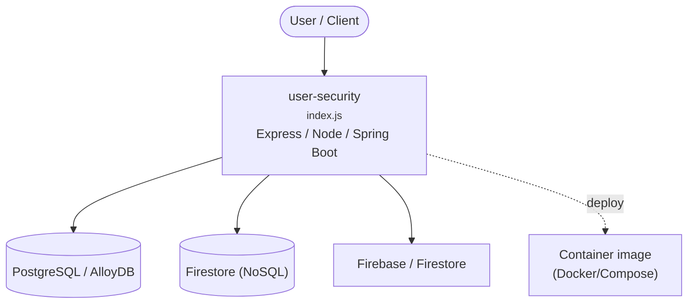

# user-security

**Project list** 
1. Group - main project for maven springboot user microservice 
2. Firestore - nodejs application to run on cloud function 
3. Group-groovy-gradle - rewritting the group project in groovy and gradle
4. Springboot/microservice - sample boilerplate template for springboot gradle and JPA.

## Index

- [Build and Run](#build)
- [NOTICE](#notice)
- [Usage](#usage)
  - [Import init.sql](#init)
  - [Config application.yml](#config)
  - [Access resources with Swagger](#swagger)
- [Deploy](#deploy)
- [License](#license)

**spring-microservices-boilerplate** is a boilerplate which is very helpful for java programmer and friendly to front end.

And build with:

- [Spring Boot](http://projects.spring.io/spring-boot/)
- [Spring OAuth 2](http://projects.spring.io/spring-security-oauth/)
- [Spring Security](http://projects.spring.io/spring-security/)
- [Spring Data JPA](http://projects.spring.io/spring-data-jpa/)

And use [specification-arg-resolver](https://github.com/tkaczmarzyk/specification-arg-resolver) for filter.

> NOTE If you need RSA sign check, you can use `validateWithSignCheck` of [ValidateHelper](src/main/java/com/saintdan/framework/component/ValidateHelper.java)

**Getting Started**
* Dockerfile 
* maven build

**To build project locally run**

* maven package
* java -jar targer/users-0.0.1-SNAPSHOT.jar

**For Docker run the following**

* docker build -t test .
* docker run -it test:latest
* Swagger API

http://localhost:8085/swagger-ui.html#/home-controller/homeUsingGET
THe default port is 8085 for the application.

<!-- ARCH-DIAGRAM:START -->

## Architecture

> Auto-generated architecture diagram. See [`docs/context-map.md`](docs/context-map.md) for the full context map (core application, containers/cloud, and database connections).

<!-- ARCH-DIAGRAM:END -->
