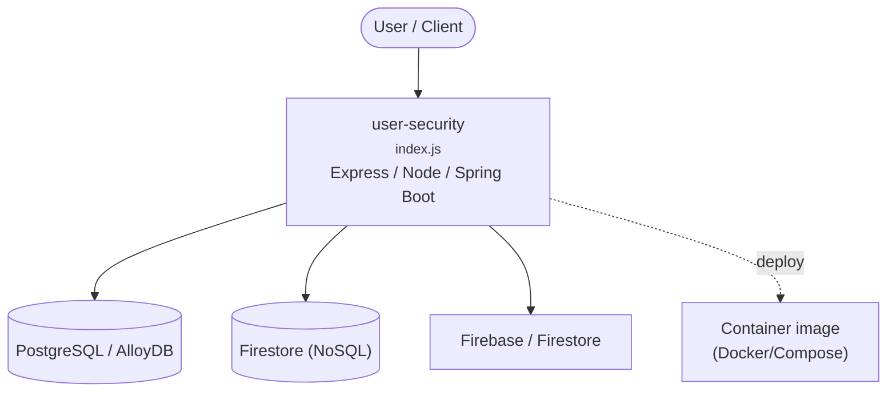

# Context Map — `user-security`

> Auto-generated architecture & deployment context map. Summarizes the core application, container/cloud footprint, and database connections. Regenerate after significant structural changes.

**Repo:** `avnit/user-security` · **Original** · Public · Primary language: Java · Default branch: `master` · Files: 260

## 1. Core application

user-security

- **Frameworks / runtime:** Express / Node, Spring Boot
- **Entry points:** `firestore/myapp/routes/index.js`, `group/src/main/java/com/asbsolutionsusers/Application.java`, `index.js`, `springboot/microservice/src/main/java/com/saintdan/framework/Application.java`
- **Listens on port(s):** 6379, 8000, 8080, 8443, 8085

## 2. Containers & cloud applications

**Containers:**
- `group/Dockerfile`
- `springboot/microservice/Dockerfile`
- `springboot/microservice/docker-compose.yml`

**Detected cloud platforms / services:** Firebase / Firestore

## 3. Database connections

**Datastores in use:** PostgreSQL / AlloyDB, Firestore (NoSQL)

**Referenced in:**
- `index.js`
- `package.json`
- `springboot/microservice/src/main/resources/application.yml`

## 4. Architecture diagram

## 5. Security posture

- **Dependabot alerts (open):** 7 critical, 29 high, 24 medium, 15 low
- **Static scan findings:** 1 medium

| Severity | Rule | File:Line |
|---|---|---|
| medium | cors-wildcard-creds | `springboot/microservice/src/main/java/com/saintdan/framework/filter/SimpleCORSFilter.java:40` |

---
_Generated by repo context-mapping pass on 2026-08-13._